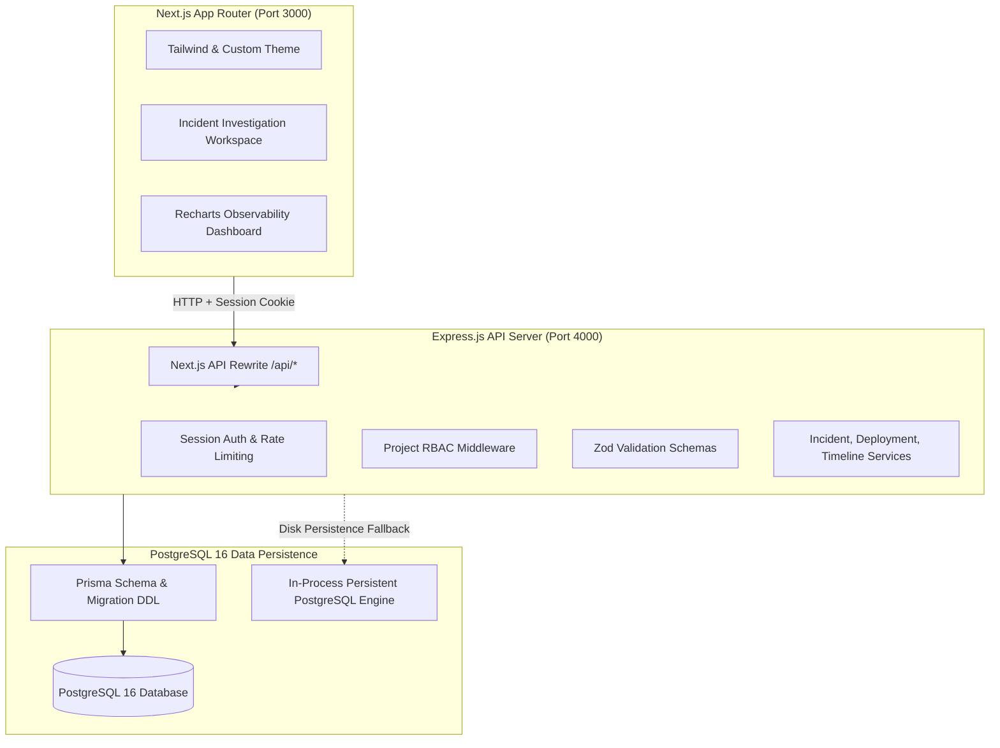

# VestiNex — Incident Intelligence & Deployment Monitoring Platform

> *Every failure leaves a trace.*

[](https://opensource.org/licenses/MIT)
[](https://www.typescriptlang.org/)
[](https://nextjs.org/)
[](https://expressjs.com/)
[](https://www.prisma.io/)
[](https://vitest.dev/)

**GitHub Repository:** [https://github.com/S-T-HARINI/VestiNex.git](https://github.com/S-T-HARINI/VestiNex.git)

---

## 1. Product Overview

When modern distributed software fails in production, development and SRE teams are forced to manually correlate alerts, CI/CD pipeline runs, Git pull requests, and telemetry logs across disjointed tools. 

**VestiNex** solves this by unifying:
1. **Chronological Failure Reconstruction**: Preserving true event occurrence time alongside telemetry ingestion delays to uncover causal chains distorted by network lag.
2. **Evidence-Based Deployment Correlation**: Identifying suspect deployments and code changes without making erroneous claims that correlation proves causation.
3. **Investigation Workspace**: Collaborative real-time incident activity stream with status workflows, runbook comments, and root-cause post-mortems.
4. **Engineering Operations Dashboard**: True operational metrics including Mean Time to Resolution (MTTR), deployment success rates, severity distributions, and recurring issue detection.

---

## 2. Technology Stack

| Domain | Technology | Key Capabilities |
| :--- | :--- | :--- |
| **Frontend** | Next.js 14 (App Router) + React 18 | Server-side rendering, client hydration, dynamic routing, reverse proxy rewrites |
| **Styling & UI** | Tailwind CSS + shadcn/ui custom theme | Midnight navy palette (`#090D16`), slate surfaces, electric indigo accents, tabular numerals |
| **Visualizations**| Recharts 2.15 | Deployment trends, incident volume, and severity distribution charts |
| **Backend API** | Node.js + Express.js + TypeScript | Clean layered architecture (Routes, Controllers, Services, Middleware) |
| **Validation** | Zod 3.24 | Schema validation on 100% of incoming request payloads |
| **Database** | PostgreSQL 16 + Prisma ORM 5.22 | 13 relational models, Prisma DDL migrations, persistent disk storage (`./pgdata`), constraints, indexes, and transactions |
| **Authentication**| Sessions + bcryptjs (Salt rounds: 10) | `httpOnly`, `sameSite: 'lax'` session cookies with session regeneration |
| **Testing** | Vitest + Supertest + Playwright | 20 automated integration tests passing in ~1s; end-to-end browser workflows |
| **DevOps** | Docker & Docker Compose | Multi-container setup (Postgres + Express API + Next.js web) |

---

## 3. High-Level Architecture



---

## 4. Key Engineering Highlights

### Dual-Timestamp Event Reconstruction
Telemetry agents, log collectors, and message queues introduce variable latency. VestiNex tracks:
- `occurredAt`: The moment the event happened inside the application.
- `ingestedAt`: The moment the event was ingested by the observability platform.

When logs arrive out-of-order due to network buffer flushes, VestiNex highlights the delay badge (e.g., `Telemetry Latency: +2m 12s` or `Out-of-Order Ingestion`), restoring the true causal timeline.

### Evidence-Based Correlation Engine
- Analyzes deployments completed within 72 hours of incident onset.
- Computes proximity confidence (`high`, `medium`, `low`) and explains the investigative lead.
- Enforces the **Evidence Policy**: *Potential correlation provides an investigative lead; causation requires commit diff verification.*

### Role-Based Access Control (RBAC)
- **OWNER**: Full administrative control over project, members, and deletion.
- **ADMIN**: Manage deployments, open incidents, add team members.
- **DEVELOPER**: Register deployments, push commits, update incident workflows.
- **VIEWER**: Read-only forensic analysis access.

---

## 5. Fast Demo Access & Pre-Seeded Accounts

The application includes rich, realistic demonstration data pre-seeded with 4 user personas, 3 software projects, multiple deployments, Git commits, and active incident investigations.

| Persona | Role | Email | Password |
| :--- | :--- | :--- | :--- |
| **Platform Lead** | System Admin / Owner | `admin@vestinex.io` | `password123` |
| **Staff SRE** | Project Admin / Developer | `dev@vestinex.io` | `password123` |
| **Backend Architect** | Developer | `lead@vestinex.io` | `password123` |
| **Incident Observer** | Read-Only Viewer | `viewer@vestinex.io` | `password123` |

*Note: The sign-in page features one-click buttons for instantaneous demo authentication.*

---

## 6. Quick Start Guide

### Option A: Local Development (Fastest)

```bash
# 1. Clone repository
git clone https://github.com/S-T-HARINI/VestiNex.git
cd VestiNex

# 2. Install dependencies
cd backend && npm install
cd ../frontend && npm install
cd ..

# 3. Start Backend (Terminal 1)
cd backend
npm run dev

# 4. Start Frontend (Terminal 2)
cd frontend
npm run dev
```

Open **`http://localhost:3000`** in your browser.

### Option B: Docker Compose

```bash
docker compose up --build
```
This launches:
- PostgreSQL on `localhost:5432`
- Express API on `localhost:4000`
- Next.js Web on `localhost:3000`

---

## 7. Running Automated Tests

```bash
# Run backend integration tests (Vitest + Supertest)
cd backend
npm test

# Output:
# ✓ tests/api.test.ts (14 tests) 184ms
# Test Files  1 passed (1)
#      Tests  14 passed (14)

# Run frontend production build verification
cd ../frontend
npm run build
```

---

## 8. REST API Summary

Full OpenAPI 3.0 specification available in [`docs/api/openapi.yaml`](./docs/api/openapi.yaml).

| Endpoint | Method | Description |
| :--- | :--- | :--- |
| `/api/auth/register` | `POST` | Register a new user |
| `/api/auth/login` | `POST` | Authenticate & issue session cookie |
| `/api/auth/me` | `GET` | Get authenticated user identity |
| `/api/auth/logout` | `POST` | Terminate session |
| `/api/projects` | `GET`, `POST` | List and create software projects |
| `/api/projects/:id` | `GET`, `PATCH` | Project details & configuration |
| `/api/projects/:id/timeline` | `GET` | Unified chronological timeline with latency filters |
| `/api/projects/:id/dashboard`| `GET` | Project operational metrics & MTTR |
| `/api/projects/:id/deployments`| `GET`, `POST` | Deployment tracking & rollout logs |
| `/api/deployments/:id/status`| `PATCH` | Transition deployment status with audit entry |
| `/api/projects/:id/code-changes`| `GET`, `POST` | Git commits & file diff metadata |
| `/api/projects/:id/incidents` | `GET`, `POST` | Incident tracking & investigation workspace |
| `/api/incidents/:id` | `GET`, `PATCH` | Incident forensics & suggested correlations |
| `/api/incidents/:id/status` | `PATCH` | Progress workflow: INVESTIGATING → IDENTIFIED → RESOLVED |
| `/api/incidents/:id/link-deployment` | `POST` | Correlate deployment to incident |
| `/api/incidents/:id/comments` | `GET`, `POST` | Investigation notes and runbook collaboration |
| `/api/dashboard/overview` | `GET` | Global multi-project operational overview |
| `/api/dashboard/audit` | `GET` | System mutation audit trail |

---

## 9. Monorepo Structure

```
VestiNex/
├── frontend/                     # Next.js 14 App Router application
│   ├── src/
│   │   ├── app/                  # 17 application routes
│   │   ├── components/           # UI components, layouts, charts, investigation workspace
│   │   ├── contexts/             # AuthContext session provider
│   │   └── lib/                  # API client & formatting utilities
│   ├── tailwind.config.ts        # Custom Midnight Observability theme
│   └── package.json
├── backend/                      # Express.js REST API
│   ├── src/
│   │   ├── routes/               # API route definitions
│   │   ├── services/             # Core business logic layer
│   │   ├── middleware/           # Auth, RBAC, Rate Limiting, Validation, Error Handling
│   │   ├── validators/           # Zod validation schemas
│   │   ├── lib/                  # In-memory store & Prisma client
│   │   └── server.ts             # Server entry point
│   ├── tests/                    # Vitest integration tests
│   └── package.json
├── prisma/
│   ├── schema.prisma             # PostgreSQL schema with 13 models
│   └── seed.ts                   # Database seed script
├── docs/
│   ├── api/openapi.yaml          # OpenAPI 3.0 specification
│   ├── architecture.md           # Architecture & forensic methodology
│   └── setup.md                  # Comprehensive setup instructions
├── e2e/                          # Playwright end-to-end tests
├── docker-compose.yml            # Docker multi-service orchestration
├── .env.example                  # Environment configuration template
└── README.md                     # Platform overview & portfolio documentation
```

---

## 10. License

Released under the [MIT License](LICENSE).
Built for technical excellence, forensic accuracy, and reliable software delivery.
