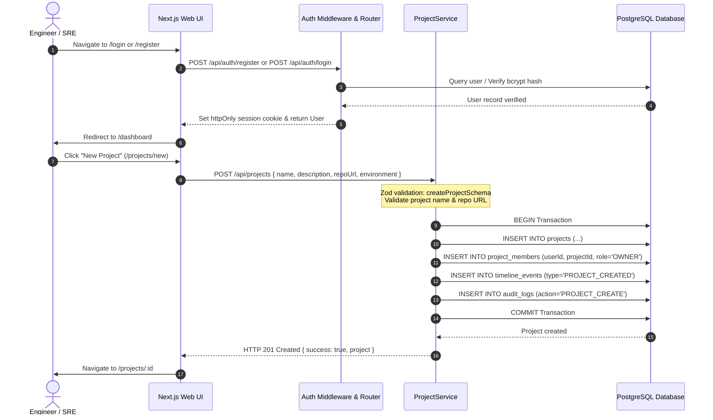
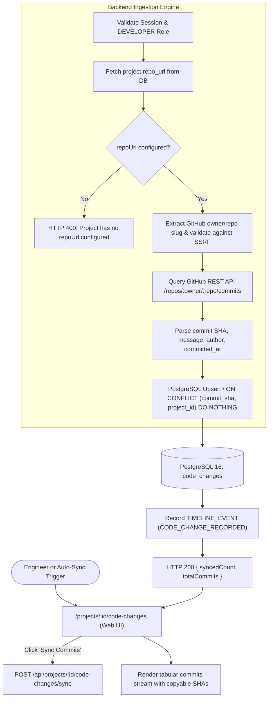
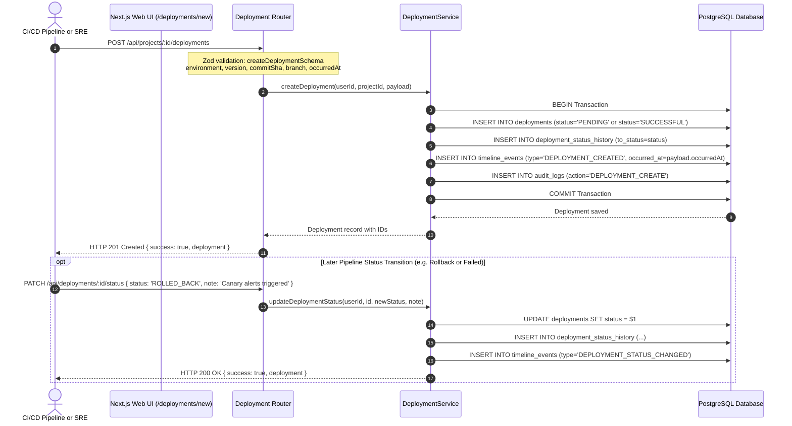
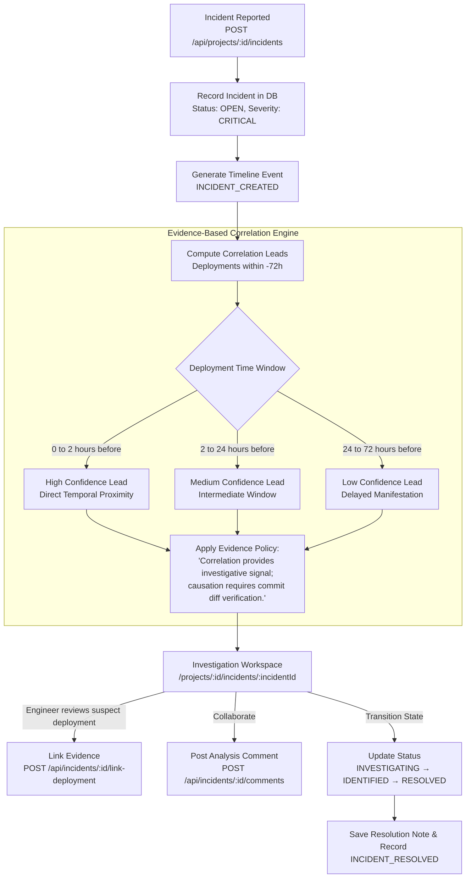

# VestiNex — Application Workflow Diagrams

> Formal architectural documentation detailing end-to-end system workflows, data transitions, participating frontend pages, Express services, and PostgreSQL models in VestiNex.

---

## Workflow A: Project Lifecycle

This workflow governs user onboarding, authentication, isolated workspace project creation, configuration (such as public Git repository linking), and ongoing project operations.

### Technical Details
- **Frontend Pages:** `/login`, `/register`, `/dashboard`, `/projects/new`, `/projects/:id/settings`.
- **Backend APIs & Services:** 
  - `POST /api/auth/register`, `POST /api/auth/login`, `GET /api/auth/me`.
  - `POST /api/projects`, `GET /api/projects/:id`, `PATCH /api/projects/:id`, `POST /api/projects/:id/archive`.
  - [`projectService`](file:///d:/projects/VestiNex/backend/src/services/project.service.ts), [`authService`](file:///d:/projects/VestiNex/backend/src/services/auth.service.ts).
- **Database Models:** `User`, `Project`, `ProjectMember`, `TimelineEvent`, `AuditLog`.
- **Validation & Error Handling:**
  - Name is required (1-100 characters).
  - Multi-tenant data isolation: Each user only sees projects they own or are invited to. Unauthorized requests return `403 Forbidden` via `requireProjectRole`.

---

## Workflow B: Code Change Ingestion

This workflow covers ingesting Git commits from configured public GitHub repositories or recording individual changes via the developer API, validating metadata, deduplicating SHAs, and publishing to the project timeline.

### Technical Details
- **Frontend Pages:** `/projects/:id/code-changes`, `/projects/:id/timeline`.
- **Backend APIs & Services:** 
  - `POST /api/projects/:id/code-changes/sync`: Ingests the latest 30 commits from GitHub.
  - `POST /api/projects/:id/code-changes`: Manual API commit recording.
  - `GET /api/projects/:id/code-changes`: Retrieves commit history.
  - [`codeChangeService`](file:///d:/projects/VestiNex/backend/src/services/codeChange.service.ts).
- **Database Models:** `CodeChange`, `Project`, `TimelineEvent`, `AuditLog`.
- **Validation & Error Handling:**
  - Strict SSRF protection ensures only valid public GitHub URLs (`github.com/owner/repo`) are accepted; private network addresses (`localhost`, `127.0.0.1`, `169.254.169.254`) are blocked.
  - Deduplication is guaranteed via PostgreSQL unique constraint `@@unique([commit_sha, project_id])`. Duplicate commits are skipped idempotently without throwing errors.

---

## Workflow C: Deployment Recording

This workflow documents how deployments are recorded in VestiNex. 

> [!NOTE]
> **Manual vs Automated Recording**: VestiNex currently provides a **recording and monitoring API** (`POST /api/projects/:id/deployments` and status transitions) intended for CI/CD integration (e.g. GitHub Actions, GitLab CI, ArgoCD webhook). VestiNex does *not* execute build binaries or cloud infrastructure rollouts itself; it tracks, logs, and correlates them.

### Technical Details
- **Frontend Pages:** `/projects/:id/deployments`, `/projects/:id/deployments/new`, `/projects/:id/deployments/:deploymentId`.
- **Backend APIs & Services:** 
  - `POST /api/projects/:id/deployments`: Register deployment.
  - `PATCH /api/deployments/:id/status`: Transition lifecycle status (`PENDING` → `RUNNING` → `SUCCESSFUL` / `FAILED` / `ROLLED_BACK`).
  - `GET /api/deployments/:id/history`: Audit trail of deployment status changes.
  - [`deploymentService`](file:///d:/projects/VestiNex/backend/src/services/deployment.service.ts).
- **Database Models:** `Deployment`, `DeploymentStatusHistory`, `TimelineEvent`, `AuditLog`.
- **Validation & Error Handling:**
  - `environment` must match enum `DEVELOPMENT`, `STAGING`, `PRODUCTION`.
  - `occurredAt` defaults to current timestamp if omitted, but accepts historical timestamps for out-of-order CI/CD event ingestion.

---

## Workflow D: Incident Investigation & Correlation

This workflow guides SREs and developers from incident registration through temporal correlation analysis, evidence linking, team discussion, and final post-mortem resolution.

### Technical Details
- **Frontend Pages:** `/projects/:id/incidents`, `/projects/:id/incidents/new`, `/projects/:id/incidents/:incidentId`.
- **Backend APIs & Services:** 
  - `POST /api/projects/:id/incidents`, `GET /api/incidents/:id`, `PATCH /api/incidents/:id/status`.
  - `POST /api/incidents/:id/link-deployment`, `DELETE /api/incidents/:id/link-deployment/:deploymentId`.
  - `POST /api/incidents/:id/comments`, `POST /api/incidents/:id/assign`.
  - [`incidentService`](file:///d:/projects/VestiNex/backend/src/services/incident.service.ts).
- **Database Models:** `Incident`, `IncidentStatusHistory`, `IncidentDeploymentLink`, `Comment`, `TimelineEvent`, `AuditLog`.
- **Validation & Error Handling:**
  - Severity must be one of `CRITICAL`, `HIGH`, `MEDIUM`, `LOW`.
  - Status follows monotonic progression; marking `RESOLVED` requires a non-empty `resolutionNote`.
  - Linking a deployment is protected by unique constraint `@@unique([incident_id, deployment_id])` preventing duplicate correlations.

---

## Workflow E: Event Ordering, Delay Detection & Concurrency

This workflow illustrates how VestiNex handles out-of-order events, network ingestion lag, and simultaneous user edits on the same incident.

```mermaid
flowchart TD
    subgraph TelemetryIngestion["Telemetry Ingestion & Latency Analysis"]
        EventIn["Event Received<br/>(occurred_at: T_occur, ingested_at: T_now)"]
        EventIn --> CalcLag["Compute delaySeconds = T_now - T_occur"]
        CalcLag --> LagCheck{"delaySeconds > 60s?"}
        LagCheck -- Yes --> MarkDelayed["Flag: isDelayed = true<br/>Badge: Delayed Telemetry (+Xs)"]
        LagCheck -- No --> MarkNormal["Flag: isDelayed = false<br/>Normal Ingestion"]
        MarkDelayed --> OrderCheck{"delaySeconds > 300s?"}
        OrderCheck -- Yes --> MarkOOO["Flag: isOutOfOrder = true<br/>Badge: Out-of-Order Ingestion"]
        OrderCheck -- No --> TimelineStream
        MarkNormal --> TimelineStream
        MarkOOO --> TimelineStream["Sort stream by occurred_at DESC<br/>(True Chronological Reconstruction)"]
    end

    subgraph ConcurrencyControl["Optimistic Concurrency Control (HTTP 409)"]
        UserA["User A starts editing Incident (reads updated_at = T0)"]
        UserB["User B submits status update (writes updated_at = T1)"]
        UserA -->|Submits update with expectedUpdatedAt = T0| ServerCheck{"DB updated_at == T0?"}
        UserB -.->|Updates DB first| DBRecord[("DB incident record")]
        DBRecord -.-> ServerCheck
        ServerCheck -- "Mismatch (|T1 - T0| > 1s)" --> ConflictErr["HTTP 409 Conflict<br/>'Incident was updated by another team member.<br/>Please refresh.'"]
        ServerCheck -- "Match" --> CommitUpdate["Update incident & bump updated_at"]
    end
```

### Technical Details
- **Frontend Pages:** `/projects/:id/timeline`, `/projects/:id/incidents/:incidentId`.
- **Backend APIs & Services:** 
  - `GET /api/projects/:id/timeline?delayedOnly=true&outOfOrderOnly=true`.
  - `PATCH /api/incidents/:id` & `PATCH /api/incidents/:id/status`.
  - [`timelineService`](file:///d:/projects/VestiNex/backend/src/services/timeline.service.ts).
- **Database Models:** `TimelineEvent`, `Incident`.
- **Validation & Error Handling:**
  - Events are sorted by physical `occurred_at DESC` rather than database arrival order, guaranteeing correct forensic event order.
  - Telemetry delay is computed and surfaced in UI badges (`+Xs`).
  - Concurrent modifications with stale `expectedUpdatedAt` trigger immediate HTTP `409 Conflict`, shielding data from accidental race conditions.
