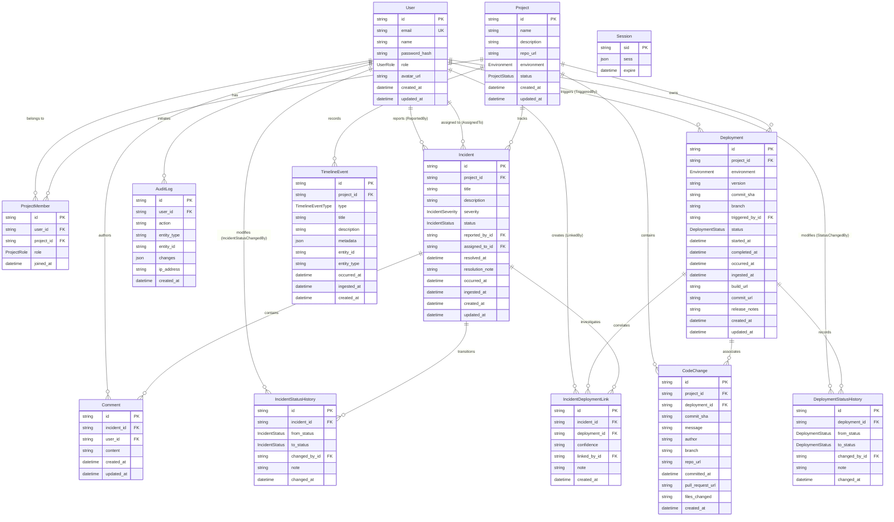

# VestiNex — Database Schema Specification

> Real database design for VestiNex Incident Intelligence & Deployment Monitoring Platform.
> Based on PostgreSQL 16 and Prisma ORM schema definition (`prisma/schema.prisma`).

---

## 1. Database Architecture Overview

VestiNex uses **PostgreSQL 16** managed via **Prisma ORM** as its persistent operational data tier. The database schema encompasses **13 relational models** and **8 enumerated types**, enforcing referential integrity, unique constraints, compound indexes, and foreign key cascades.

### Key Data Principles
1. **Dual-Timestamp Tracking**: Every operational event (`deployments`, `incidents`, `timeline_events`) tracks both:
   - `occurred_at`: The physical or logical time the event occurred in the system.
   - `ingested_at`: The time the telemetry ingestion pipeline accepted and recorded the event in the database.
   - This enables forensic reconstruction of out-of-order and delayed events.
2. **Deduplication Constraints**:
   - `code_changes`: `@@unique([commit_sha, project_id])` prevents duplicate Git commits from being ingested into the same project.
   - `project_members`: `@@unique([user_id, project_id])` prevents duplicate memberships.
   - `incident_deployment_links`: `@@unique([incident_id, deployment_id])` prevents duplicate correlation links between an incident and deployment.
   - `users`: `@@unique([email])` prevents duplicate registrations.
3. **Concurrency and Conflict Handling**:
   - Updates to `incidents` support optimistic concurrency control via an `expectedUpdatedAt` timestamp verification. If the row's `updated_at` on disk deviates from the client's expected timestamp by more than 1 second, a `409 Conflict` exception is thrown to prevent silent overwrites.
   - Multi-record workflows (incident registration, status transitions, deployment registration) run inside ACID database transactions (`pgDb.transaction`).

---

## 2. Mermaid Entity-Relationship (ER) Diagram

---

## 3. Enumerated Types (Enums)

| Enum Name | Allowed Values | Usage |
| :--- | :--- | :--- |
| `UserRole` | `ADMIN`, `USER` | Global system role (system administration) |
| `ProjectRole` | `OWNER`, `ADMIN`, `DEVELOPER`, `VIEWER` | Project-scoped Role-Based Access Control |
| `ProjectStatus` | `ACTIVE`, `ARCHIVED` | Project operational lifecycle status |
| `Environment` | `DEVELOPMENT`, `STAGING`, `PRODUCTION` | Target runtime environment |
| `DeploymentStatus` | `PENDING`, `RUNNING`, `SUCCESSFUL`, `FAILED`, `ROLLED_BACK` | Lifecycle status of a software deployment |
| `IncidentSeverity` | `CRITICAL`, `HIGH`, `MEDIUM`, `LOW` | Incident urgency and impact classification |
| `IncidentStatus` | `OPEN`, `INVESTIGATING`, `IDENTIFIED`, `MONITORING`, `RESOLVED`, `CLOSED` | State-machine workflow for incident resolution |
| `TimelineEventType`| `DEPLOYMENT_CREATED`, `DEPLOYMENT_STATUS_CHANGED`, `INCIDENT_CREATED`, `INCIDENT_STATUS_CHANGED`, `INCIDENT_ASSIGNED`, `INCIDENT_RESOLVED`, `CODE_CHANGE_RECORDED`, `MEMBER_ADDED`, `MEMBER_REMOVED`, `COMMENT_ADDED`, `PROJECT_CREATED`, `PROJECT_UPDATED` | Discrete unified event type in chronological log |

---

## 4. Detailed Table Specifications

### 4.1. `users`
Stores user identities, credentials, and global system roles.

| Column | Type | Nullable | Default | Constraints & Description |
| :--- | :--- | :--- | :--- | :--- |
| `id` | `VARCHAR(30)` | No | `cuid()` | Primary Key |
| `email` | `VARCHAR(255)`| No | None | Unique constraint (`UNIQUE`) |
| `name` | `VARCHAR(255)`| No | None | User's full display name |
| `password_hash`| `VARCHAR(255)`| No | None | bcrypt hashed password (salt rounds: 10) |
| `role` | `UserRole` | No | `USER` | Global role (`ADMIN` or `USER`) |
| `avatar_url` | `TEXT` | Yes | `NULL` | Public avatar image URI |
| `created_at` | `TIMESTAMPTZ` | No | `now()` | Record creation timestamp |
| `updated_at` | `TIMESTAMPTZ` | No | Auto | Record modification timestamp |

---

### 4.2. `session`
Managed by `express-session` and connect-pg-simple for session persistence.

| Column | Type | Nullable | Default | Constraints & Description |
| :--- | :--- | :--- | :--- | :--- |
| `sid` | `VARCHAR(255)`| No | None | Primary Key (Session ID) |
| `sess` | `JSON` | No | None | Serialized session object (contains `userId`) |
| `expire` | `TIMESTAMP(6)`| No | None | Expiration timestamp; indexed (`IDX_session_expire`) |

---

### 4.3. `projects`
Workspaces isolating deployments, code commits, incidents, and members.

| Column | Type | Nullable | Default | Constraints & Description |
| :--- | :--- | :--- | :--- | :--- |
| `id` | `VARCHAR(30)` | No | `cuid()` | Primary Key |
| `name` | `VARCHAR(255)`| No | None | Project name |
| `description`| `TEXT` | Yes | `NULL` | Technical description / service scope |
| `repo_url` | `VARCHAR(500)`| Yes | `NULL` | Public GitHub or Git repository URL |
| `environment`| `Environment` | No | `DEVELOPMENT` | Target environment |
| `status` | `ProjectStatus`| No | `ACTIVE` | Operational status (`ACTIVE` or `ARCHIVED`) |
| `created_at` | `TIMESTAMPTZ` | No | `now()` | Project creation timestamp |
| `updated_at` | `TIMESTAMPTZ` | No | Auto | Project configuration update timestamp |

---

### 4.4. `project_members`
Implements project-scoped Role-Based Access Control (RBAC).

| Column | Type | Nullable | Default | Constraints & Description |
| :--- | :--- | :--- | :--- | :--- |
| `id` | `VARCHAR(30)` | No | `cuid()` | Primary Key |
| `user_id` | `VARCHAR(30)` | No | None | Foreign Key → `users.id` (ON DELETE CASCADE) |
| `project_id` | `VARCHAR(30)` | No | None | Foreign Key → `projects.id` (ON DELETE CASCADE) |
| `role` | `ProjectRole` | No | `DEVELOPER`| Project role (`OWNER`, `ADMIN`, `DEVELOPER`, `VIEWER`) |
| `joined_at` | `TIMESTAMPTZ` | No | `now()` | Membership assignment timestamp |

**Indexes & Constraints:**
- `@@unique([user_id, project_id])`: Ensures a user can only have one membership record per project.
- `@@index([project_id])`: Fast member lookup by project.

---

### 4.5. `deployments`
Tracks application deployment events, target environments, and build metadata.

| Column | Type | Nullable | Default | Constraints & Description |
| :--- | :--- | :--- | :--- | :--- |
| `id` | `VARCHAR(30)` | No | `cuid()` | Primary Key |
| `project_id` | `VARCHAR(30)` | No | None | Foreign Key → `projects.id` (ON DELETE CASCADE) |
| `environment`| `Environment` | No | None | Target environment |
| `version` | `VARCHAR(100)`| Yes | `NULL` | Release semantic version or build tag |
| `commit_sha` | `VARCHAR(64)` | Yes | `NULL` | Git commit SHA |
| `branch` | `VARCHAR(255)`| Yes | `NULL` | Git branch name |
| `triggered_by_id` | `VARCHAR(30)` | Yes | `NULL` | Foreign Key → `users.id` (ON DELETE SET NULL) |
| `status` | `DeploymentStatus` | No | `PENDING` | Current status |
| `started_at` | `TIMESTAMPTZ` | Yes | `NULL` | Deployment initiation timestamp |
| `completed_at` | `TIMESTAMPTZ` | Yes | `NULL` | Deployment completion timestamp |
| `occurred_at` | `TIMESTAMPTZ` | No | `now()` | Telemetry timestamp when deployment completed |
| `ingested_at` | `TIMESTAMPTZ` | No | `now()` | System timestamp when record was stored |
| `build_url` | `VARCHAR(500)`| Yes | `NULL` | CI/CD build run URL |
| `commit_url`| `VARCHAR(500)`| Yes | `NULL` | Git commit web URL |
| `release_notes` | `TEXT` | Yes | `NULL` | Release notes / changelog summary |
| `created_at` | `TIMESTAMPTZ` | No | `now()` | Record creation timestamp |
| `updated_at` | `TIMESTAMPTZ` | No | Auto | Record update timestamp |

**Indexes:**
- `@@index([project_id, environment, status])`: Filtered deployment queries.
- `@@index([project_id, occurred_at])`: Chronological timeline queries.

---

### 4.6. `deployment_status_history`
Maintains an immutable audit log of deployment state transitions.

| Column | Type | Nullable | Default | Constraints & Description |
| :--- | :--- | :--- | :--- | :--- |
| `id` | `VARCHAR(30)` | No | `cuid()` | Primary Key |
| `deployment_id` | `VARCHAR(30)` | No | None | Foreign Key → `deployments.id` (ON DELETE CASCADE) |
| `from_status` | `DeploymentStatus` | Yes | `NULL` | Previous status |
| `to_status` | `DeploymentStatus` | No | None | New status |
| `changed_by_id` | `VARCHAR(30)` | Yes | `NULL` | Foreign Key → `users.id` (ON DELETE SET NULL) |
| `note` | `TEXT` | Yes | `NULL` | Operational reason for status transition |
| `changed_at` | `TIMESTAMPTZ` | No | `now()` | Transition timestamp |

**Indexes:**
- `@@index([deployment_id, changed_at])`: Ordered transition history.

---

### 4.7. `code_changes`
Stores Git commits associated with projects and deployments.

| Column | Type | Nullable | Default | Constraints & Description |
| :--- | :--- | :--- | :--- | :--- |
| `id` | `VARCHAR(30)` | No | `cuid()` | Primary Key |
| `project_id` | `VARCHAR(30)` | No | None | Foreign Key → `projects.id` (ON DELETE CASCADE) |
| `deployment_id` | `VARCHAR(30)` | Yes | `NULL` | Foreign Key → `deployments.id` (ON DELETE SET NULL) |
| `commit_sha` | `VARCHAR(64)` | No | None | Git commit hash |
| `message` | `TEXT` | No | None | Git commit message |
| `author` | `VARCHAR(255)`| No | None | Commit author name/email |
| `branch` | `VARCHAR(255)`| Yes | `NULL` | Git branch name |
| `repo_url` | `VARCHAR(500)`| Yes | `NULL` | Repository URL |
| `committed_at`| `TIMESTAMPTZ` | No | None | Git commit timestamp |
| `pull_request_url`| `VARCHAR(500)`| Yes | `NULL` | Pull Request link |
| `files_changed` | `TEXT` | Yes | `NULL` | List of modified files / diff summary |
| `created_at` | `TIMESTAMPTZ` | No | `now()` | Ingestion timestamp |

**Indexes & Constraints:**
- `@@unique([commit_sha, project_id])`: Enforces idempotency; prevents duplicate ingestion of the same commit in a project.
- `@@index([project_id, committed_at])`: Chronological commit listing.

---

### 4.8. `incidents`
Tracks outages, failures, investigations, severity, and resolution.

| Column | Type | Nullable | Default | Constraints & Description |
| :--- | :--- | :--- | :--- | :--- |
| `id` | `VARCHAR(30)` | No | `cuid()` | Primary Key |
| `project_id` | `VARCHAR(30)` | No | None | Foreign Key → `projects.id` (ON DELETE CASCADE) |
| `title` | `VARCHAR(255)`| No | None | Incident title |
| `description`| `TEXT` | Yes | `NULL` | Incident description / forensic notes |
| `severity` | `IncidentSeverity` | No | None | `CRITICAL`, `HIGH`, `MEDIUM`, `LOW` |
| `status` | `IncidentStatus` | No | `OPEN` | `OPEN`, `INVESTIGATING`, `IDENTIFIED`, `MONITORING`, `RESOLVED`, `CLOSED` |
| `reported_by_id` | `VARCHAR(30)` | No | None | Foreign Key → `users.id` (ON DELETE RESTRICT) |
| `assigned_to_id` | `VARCHAR(30)` | Yes | `NULL` | Foreign Key → `users.id` (ON DELETE SET NULL) |
| `resolved_at` | `TIMESTAMPTZ` | Yes | `NULL` | Timestamp incident entered resolved state |
| `resolution_note`| `TEXT` | Yes | `NULL` | Post-mortem resolution summary |
| `occurred_at` | `TIMESTAMPTZ` | No | `now()` | Physical timestamp failure began |
| `ingested_at` | `TIMESTAMPTZ` | No | `now()` | Telemetry timestamp failure was logged |
| `created_at` | `TIMESTAMPTZ` | No | `now()` | Record creation timestamp |
| `updated_at` | `TIMESTAMPTZ` | No | Auto | Concurrency check timestamp |

**Indexes:**
- `@@index([project_id, severity, status])`: Filtered incident searches.
- `@@index([project_id, occurred_at])`: Chronological incident listing.
- `@@index([assigned_to_id])`: User assignment queries.

---

### 4.9. `incident_status_history`
Tracks the complete lifecycle history of an incident.

| Column | Type | Nullable | Default | Constraints & Description |
| :--- | :--- | :--- | :--- | :--- |
| `id` | `VARCHAR(30)` | No | `cuid()` | Primary Key |
| `incident_id`| `VARCHAR(30)` | No | None | Foreign Key → `incidents.id` (ON DELETE CASCADE) |
| `from_status`| `IncidentStatus` | Yes | `NULL` | Status before transition |
| `to_status` | `IncidentStatus` | No | None | Status after transition |
| `changed_by_id` | `VARCHAR(30)` | Yes | `NULL` | Foreign Key → `users.id` (ON DELETE SET NULL) |
| `note` | `TEXT` | Yes | `NULL` | Transition explanation |
| `changed_at` | `TIMESTAMPTZ` | No | `now()` | Timestamp of transition |

**Indexes:**
- `@@index([incident_id, changed_at])`: Ordered transition history.

---

### 4.10. `incident_deployment_links`
Explicit forensic correlation between an incident and a suspect deployment.

| Column | Type | Nullable | Default | Constraints & Description |
| :--- | :--- | :--- | :--- | :--- |
| `id` | `VARCHAR(30)` | No | `cuid()` | Primary Key |
| `incident_id`| `VARCHAR(30)` | No | None | Foreign Key → `incidents.id` (ON DELETE CASCADE) |
| `deployment_id` | `VARCHAR(30)` | No | None | Foreign Key → `deployments.id` (ON DELETE CASCADE) |
| `confidence` | `VARCHAR(50)` | Yes | `NULL` | Proximity confidence (`high`, `medium`, `low`) |
| `linked_by_id` | `VARCHAR(30)` | Yes | `NULL` | Foreign Key → `users.id` (ON DELETE SET NULL) |
| `note` | `TEXT` | Yes | `NULL` | Forensic rationale for linkage |
| `created_at` | `TIMESTAMPTZ` | No | `now()` | Link creation timestamp |

**Indexes & Constraints:**
- `@@unique([incident_id, deployment_id])`: Prevents duplicate linkage of the same deployment to an incident.

---

### 4.11. `comments`
Collaborative investigation notes on an incident.

| Column | Type | Nullable | Default | Constraints & Description |
| :--- | :--- | :--- | :--- | :--- |
| `id` | `VARCHAR(30)` | No | `cuid()` | Primary Key |
| `incident_id`| `VARCHAR(30)` | No | None | Foreign Key → `incidents.id` (ON DELETE CASCADE) |
| `user_id` | `VARCHAR(30)` | No | None | Foreign Key → `users.id` (ON DELETE CASCADE) |
| `content` | `TEXT` | No | None | Markdown/plain text investigation note |
| `created_at` | `TIMESTAMPTZ` | No | `now()` | Comment submission timestamp |
| `updated_at` | `TIMESTAMPTZ` | No | Auto | Comment update timestamp |

**Indexes:**
- `@@index([incident_id, created_at])`: Chronological comment stream.

---

### 4.12. `timeline_events`
Unified, project-wide chronological stream for forensic replay.

| Column | Type | Nullable | Default | Constraints & Description |
| :--- | :--- | :--- | :--- | :--- |
| `id` | `VARCHAR(30)` | No | `cuid()` | Primary Key |
| `project_id` | `VARCHAR(30)` | No | None | Foreign Key → `projects.id` (ON DELETE CASCADE) |
| `type` | `TimelineEventType` | No | None | Type of event |
| `title` | `VARCHAR(255)`| No | None | Event headline |
| `description`| `TEXT` | Yes | `NULL` | Detailed context |
| `metadata` | `JSON` | Yes | `NULL` | Structured payload (e.g. commitSha, status) |
| `entity_id` | `VARCHAR(30)` | Yes | `NULL` | ID of underlying entity (incident, deployment, etc.) |
| `entity_type`| `VARCHAR(50)` | Yes | `NULL` | Type of entity (`INCIDENT`, `DEPLOYMENT`, etc.) |
| `occurred_at` | `TIMESTAMPTZ` | No | `now()` | True event occurrence timestamp |
| `ingested_at` | `TIMESTAMPTZ` | No | `now()` | Database ingestion timestamp |
| `created_at` | `TIMESTAMPTZ` | No | `now()` | Row creation timestamp |

**Indexes:**
- `@@index([project_id, occurred_at])`: Fast chronological event replay.
- `@@index([entity_type, entity_id])`: Cross-referencing entity events.

---

### 4.13. `audit_logs`
System-wide immutable mutation log.

| Column | Type | Nullable | Default | Constraints & Description |
| :--- | :--- | :--- | :--- | :--- |
| `id` | `VARCHAR(30)` | No | `cuid()` | Primary Key |
| `user_id` | `VARCHAR(30)` | Yes | `NULL` | Foreign Key → `users.id` (ON DELETE SET NULL) |
| `action` | `VARCHAR(100)`| No | None | Mutation action (e.g., `INCIDENT_CREATE`, `DEPLOYMENT_STATUS`) |
| `entity_type`| `VARCHAR(50)` | No | None | Target entity type (`INCIDENT`, `DEPLOYMENT`, `PROJECT`) |
| `entity_id` | `VARCHAR(30)` | No | None | Target entity ID |
| `changes` | `JSON` | Yes | `NULL` | Before/after mutation delta payload |
| `ip_address` | `VARCHAR(45)` | Yes | `NULL` | Client IP address |
| `created_at` | `TIMESTAMPTZ` | No | `now()` | Log creation timestamp |

**Indexes:**
- `@@index([entity_type, entity_id])`: Entity audit trail.
- `@@index([user_id, created_at])`: User activity log.

---

## 5. Schema Limitations & Design Decisions

1. **Embedded vs External PostgreSQL**: In local development mode (`NODE_ENV !== 'production'`), VestiNex supports an embedded disk-backed PostgreSQL engine persisting to `./pgdata` for zero-setup execution. In production mode, an external PostgreSQL connection string is strictly enforced.
2. **Git Commit Deduplication Scope**: Commits are deduplicated scoped to a project (`@@unique([commit_sha, project_id])`). The same Git commit SHA can legitimately exist in multiple distinct projects if teams share submodules or fork repositories.
3. **Optimistic Locking**: Handled via timestamp checking on `updated_at` rather than an explicit integer `version` column. This provides lightweight concurrency detection without requiring client migration steps.
